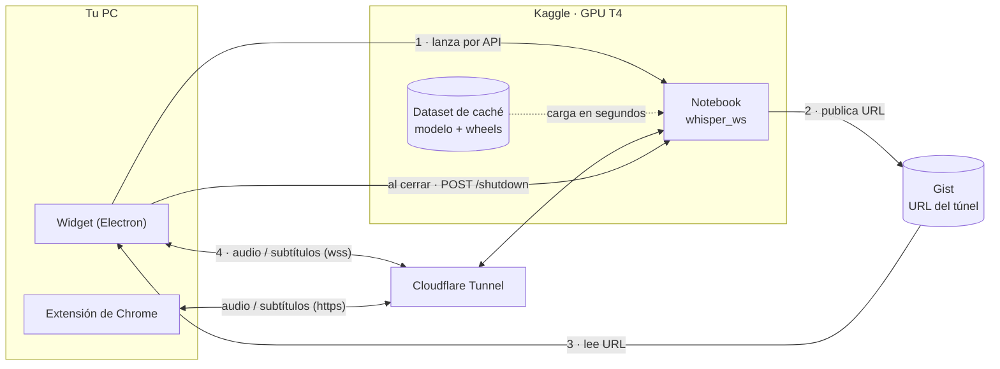

<div align="center">

# Traductor de Audios

**Subtítulos en vivo, traducidos, del audio que estás oyendo.**

[](https://github.com/SYSTRAN/faster-whisper)
[](backend/)
[](backend/whisper_ws/server.py)
[](widget/)
[](manifest.json)
[](https://www.kaggle.com/)
[](https://developers.cloudflare.com/cloudflare-one/connections/connect-networks/)
[](LICENSE)

</div>

Un backend con Whisper en una GPU gratuita de Kaggle (o Colab) transcribe y
traduce fragmentos de audio. Dos clientes se lo mandan:

| Cliente | Qué oye | Dónde se ve |
|---|---|---|
| **Extensión de Chrome** (raíz del repo) | La pestaña activa | Caja de subtítulos sobre la página |
| **Widget de escritorio** ([`widget/`](widget/README.md)) | Todo Windows, o un programa concreto | Ventana flotante siempre encima, incluso en juegos |

## Cómo funciona



1. Pulsas **Escuchar**. Si el backend no responde, el widget lanza el notebook
   en Kaggle por API.
2. El notebook carga el modelo desde la caché, abre un túnel de Cloudflare y
   publica la URL en un gist.
3. El widget lee la URL del gist y conecta por WebSocket. Tarda 1-2 minutos la
   primera vez de cada sesión.
4. Cada fragmento de audio vuelve transcrito y traducido en menos de un
   segundo. Al cerrar el widget, el notebook se apaga para no gastar cuota.

Todo gratis: Kaggle regala 30 h de GPU a la semana, el túnel y el gist no
cuestan nada.

## Inicio rápido

**Modo manual** (vale para la extensión y para el widget):

1. Abre [`backend/colab_whisper_ws.ipynb`](backend/colab_whisper_ws.ipynb) en
   Kaggle o Colab con GPU y ejecuta las tres celdas.
2. Copia la URL `https://….trycloudflare.com` que imprime la celda 3.
3. Pégala en la extensión o en **⚙ Ajustes → Pegar** del widget.

**Modo automático** (solo widget): configúralo una vez siguiendo
[Arranque automático](widget/README.md#arranque-automático-sin-abrir-kaggle)
y olvídate del navegador.

## Backend

El servidor vive en el paquete [`backend/whisper_ws/`](backend/whisper_ws/).
El notebook solo clona el repo y lo llama, así que se actualiza solo al
reejecutar la celda 1.

| Celda | Qué hace |
|---|---|
| 1 · Código y dependencias | `git clone` del repo y [`setup_env.py`](backend/setup_env.py): instala desde la caché si existe, si no desde internet |
| 2 · Modelo y servidor | `start()`: elige `float16`/`int8` según la GPU, precalienta CUDA y arranca FastAPI en `:8000` |
| 3 · Túnel y espera | `open_tunnel()` + `publish()` + `wait_until_idle()`: mantiene vivo el notebook hasta que nadie lo use |

### API

| Endpoint | Uso |
|---|---|
| `GET /ws` | WebSocket. Un fragmento binario por mensaje; devuelve texto, traducción, idioma y tiempos. Lo usa el widget |
| `POST /transcribe` | HTTP multipart. Lo usa la extensión y el widget como respaldo |
| `GET /health` | Estado, GPU, modelo, segundos de inactividad |
| `POST /shutdown` | Termina el notebook. Lo manda el widget al cerrarse |

El notebook también se apaga solo tras **10 minutos sin clientes** o a las
11,5 horas (Kaggle corta a las 12).

### Caché de arranque rápido

Sin caché cada sesión descarga el modelo (1,6 GB) y las dependencias. Con un
Kaggle Dataset el túnel está listo en unos 70 segundos. Se genera una vez:

```bash
pip install huggingface_hub kaggle
python backend/build_cache.py --kaggle-user TU_USUARIO   # ./whisper_ws_cache (~1,8 GB)
kaggle datasets create -p whisper_ws_cache --dir-mode zip
```

Luego, en el notebook, *Add Input → Datasets → whisper-ws-cache*. La celda 1
la detecta en `/kaggle/input`. En Colab sirve la misma carpeta en
`MyDrive/whisper_ws_cache`, generada con `--cuda-libs`. Si Kaggle cambia de
versión de Python, regenera con `--python X.Y` y sube una versión nueva con
`kaggle datasets version`.

### Lanzar desde la terminal

[`backend/kernel-metadata.json`](backend/kernel-metadata.json) describe el
notebook (GPU, internet, dataset). Con el CLI oficial:

```bash
kaggle kernels push -p backend
kaggle kernels status usuario/whisper-ws-cache2
```

## Extensión de Chrome

En `chrome://extensions` activa *Modo desarrollador → Cargar descomprimida* y
apunta a la **raíz del repo** (no a `widget/`). El icono abre un popup:

| Campo | Para qué |
|---|---|
| **Backend de transcripción** | URL de `/transcribe` |
| **Pegar** | Toma la URL del portapapeles y completa `/transcribe` si falta |
| **Traducir a** | Idioma de destino |
| **Iniciar / Detener** | Captura de la pestaña activa |

URL e idioma se guardan en `chrome.storage.local` y se leen en cada envío: si
el túnel cambia de dominio, pegas la nueva y listo. El manifest solo permite
`localhost:8000` y `*.trycloudflare.com`; con otro host la extensión pide
permiso al guardar.

## Widget de escritorio

Captura el audio de Windows (o de un programa concreto vía VB-CABLE), se queda
encima de cualquier aplicación y se puede reducir a una barra de letras.

```bash
cd widget
npm install     # solo la primera vez
npm start       # o iniciar.bat
```

Guía completa, atajos y ajustes: [widget/README.md](widget/README.md).

## Estructura del repositorio

```
backend/
  colab_whisper_ws.ipynb   notebook de tres celdas (Kaggle / Colab)
  setup_env.py             celda 1: entorno, con o sin caché
  build_cache.py           genera el dataset de caché
  kernel-metadata.json     descripción del notebook para la API de Kaggle
  whisper_ws/
    server.py              modelo, FastAPI, WebSocket, apagado por inactividad
    translate.py           Google Translate con tres puertas, caché y cuarentena
    tunnel.py              cloudflared
    gist.py                publica la URL del túnel
    cache.py               localiza la caché (Kaggle, Drive, variable de entorno)
    cuda_libs.py           carga cuDNN/cuBLAS de pip antes que torch
widget/                    aplicación Electron (ver su README)
manifest.json, *.js        extensión de Chrome
```

## Licencia

[MIT](LICENSE).
